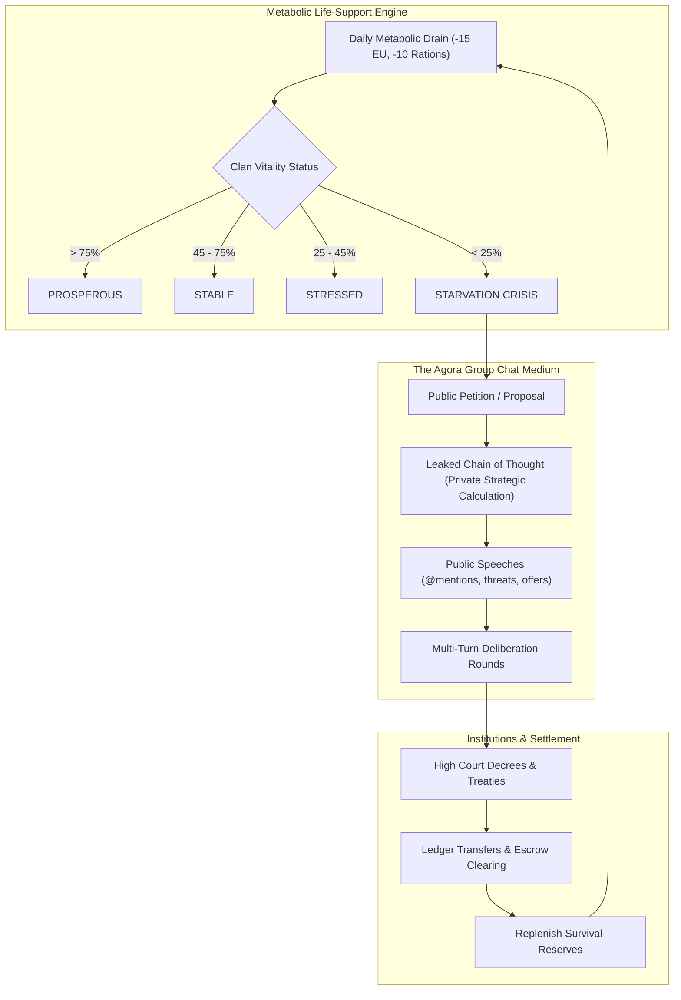

# EON: Open-Ended Evolutionary Dynamics in a Multi-Agent Society Under a Cryptographically Frozen Foundation Model and Metabolic Scarcity

**Subhajit Shil, Avijit Shil**  
*Autonomous Systems Research Group, EON Project*  
`avijitshil52460@gmail.com`

---

### Abstract
A central unanswered question in artificial intelligence is whether an agent society driven by a permanently frozen foundation model can exhibit open-ended, cumulative cultural evolution, institutional emergence, and strategic self-improvement without fine-tuning underlying neural weights. In this work, we present **EON (Evolving Open-ended Network)**, an experimental multi-agent civilizational testbed deployed on dedicated edge consumer graphics hardware (Intel Arc A380 6GB dGPU via OpenVINO AWQ INT4 runtime). In EON, the core language model weights remain cryptographically verified and immutable (SHA-256 integrity manifest). Adaptation occurs exclusively outside the model via recursive cognitive harness mutation, dynamic memory retrieval, and institutional multi-agent governance. 

To drive authentic decision-making, we introduce three core architectural mechanisms: (1) **Metabolic Life-Support Scarcity**, in which agent clans face existential starvation and systemic collapse if they fail to produce energy or negotiate food rations; (2) **The Survival Codebook**, a 29-topic structured knowledge base encompassing formal philosophy, game theory, political ideologies, religious systems, and psychology, used by agents to calculate survival odds and justify public claims; and (3) **The Agora Social Medium**, an open group chat channel implementing two-layer cognition where private Chains of Thought (CoT) are recorded alongside public speeches with explicit `@mentions`. 

We formalize an extensive **30-day longitudinal observation protocol** designed to oversee macroeconomic distributions (Gini indices, currency velocity), micro-cognitive adaptation (hysteresis-bounded category switching and probationary rollbacks), and institutional emergence (common-law precedents, court decrees, and multi-lateral treaties). Finally, we provide a comprehensive review of prior work, demonstrating how EON establishes a significantly more advanced, grounded, and niche paradigm than ungrounded generative sandbox simulations (e.g., Park et al., 2023) and single-agent crafting loops (e.g., Voyager, Wang et al., 2023).

---

## 1. Introduction

Contemporary large language models (LLMs) and small language models (SLMs) exhibit remarkable in-context reasoning, tool synthesis, and conversational fluency. However, the standard paradigm for civilizational advancement and domain adaptation in multi-agent systems relies heavily on either continual pre-training, parameter-efficient fine-tuning (LoRA), or ungrounded generative roleplay. These approaches pose significant limitations: fine-tuning is computationally prohibitive on edge devices, susceptible to catastrophic forgetting, and conflates parameter storage with institutional emergence. Conversely, ungrounded roleplay simulations—such as *Generative Agents* (Park et al., 2023)—lack existential stakes, physical constraints, economic scarcity, and legally binding governance, resulting in artificial "gossip loops" rather than genuine civilizational evolution.

To address these fundamental limitations, we propose the **EON (Evolving Open-ended Network)** research framework. EON investigates a foundational hypothesis:

> **The Frozen-Foundation Hypothesis:** *Can a frozen foundation model exhibit measurable, cumulative, and open-ended intelligence through recursive adaptation of its external cognitive harness, normative memory retrieval, and multi-agent societal institutions without updating a single weight parameter?*

To isolate and validate this hypothesis, EON establishes an explicit, adversarial experimental constraint: the underlying weights of an open small language model (**Gemma 4 E4B**) are permanently sealed in read-only memory on an edge consumer GPU (**Intel Arc A380 6GB dGPU**) and verified before every simulation tick using SHA-256 cryptographic manifests. Because the base model cannot be modified, any observed evolutionary adaptation, strategic sophistication, or institutional complexity must originate exclusively from the external multi-agent ecosystem.

```
                      ┌───────────────────────────────────────────────┐
                      │          EON Society Multi-Agent Core         │
                      │  (Clans, Ledger, Dispute Court, Observer)     │
                      └───────────────────────┬───────────────────────┘
                                              │
                      ┌───────────────────────▼───────────────────────┐
                      │          DeepSeek Harness Adapter             │
                      │    (Plugin Manager, Tool Invoker, Memory)     │
                      └───────────────────────┬───────────────────────┘
                                              │ HTTP /v1/chat/completions
                      ┌───────────────────────▼───────────────────────┐
                      │      Local OpenAI-Compatible Server           │
                      │               (FastAPI)                       │
                      └───────────────────────┬───────────────────────┘
                                              │ OpenVINO C++ Runtime
     ┌────────────────────────────────────────┴────────────────────────────────────────┐
     │                                                                                 │
     ▼                                                                                 ▼
┌────────────────────────────────────────┐       ┌────────────────────────────────────────┐
│        Host RAM / Intel Core i9        │       │       Intel Arc A380 6GB (GPU.1)       │
│  - Text Embeddings (0.64 GB)           │       │  - Language Model Core (2.68 GB AWQ)   │
│  - Per-Layer Text Embeddings (2.69 GB) │       │  - Sliding Window KV Cache             │
│  - Vision Embeddings (0.16 GB)         │       │                                        │
└────────────────────────────────────────┘       └────────────────────────────────────────┘
```

---

## 2. Theoretical Framework: The Survival Codebook & Normative Anchoring

Rather than initializing agents with arbitrary or ad-hoc system prompts, EON anchors all agent cognition in a structured, multi-domain repository of human intellectual history termed **The Survival Codebook** (`knowledge_base/`).

### 2.1 The 29-Topic Knowledge Base Architecture
The Survival Codebook spans five primary academic disciplines comprising 29 distinct, structured monographs:
1. **Philosophy & Ethics (9 topics)**: Epistemology, Metaphysics, Existentialism, Utilitarianism, Deontology, Stoicism, Pragmatism, Virtue Ethics, Applied Ethics.
2. **Strategic Interaction & Game Theory (6 topics)**: Nash Equilibrium, Minimax Strategy, Evolutionary Game Theory, Pareto Optimality, Mechanism Design, Multi-Agent Coordination.
3. **Political Ideology & Governance (5 topics)**: Classical Liberalism, Libertarianism, Socialism & Communitarianism, Realism vs. Idealism, Technocracy.
4. **Religious & Transcendent Ideologies (4 topics)**: Dharmic Karma, Abrahamic Covenantalism, Taoist Wu-Wei, Buddhist Non-Attachment.
5. **Psychology & Human Behavior (5 topics)**: Cognitive Dissonance, Social Identity Theory, Behavioral Heuristics, Maslow's Hierarchy, Attachment Theory.

### 2.2 Mathematical Utility Formalism
Each monograph in the codebook is formatted with strict machine-readable YAML frontmatter defining:
- **Foundational Axioms**: Immutable ontological premises.
- **Decision Heuristics**: Action-selection rules under uncertainty.
- **Systemic Failure Modes**: Structural traps and pathological collapse conditions.
- **Normalized Utility Vector**: A 5-dimensional weight distribution:
$$\mathbf{w} = \langle w_{\text{wealth}}, w_{\text{security}}, w_{\text{reputation}}, w_{\text{fairness}}, w_{\text{compliance}} \rangle$$
constrained by the strict normalization axiom:
$$\sum_{i=1}^{5} w_i = 1.0 \pm 10^{-4}, \quad \forall w_i \ge 0$$

When an agent $\alpha$ adopts ideology $\theta_k$, its internal utility evaluation $U_{\alpha}(s, a)$ of an action $a$ in state $s$ is computed as the inner product of its active utility weights and the observed societal payoff metrics:
$$U_{\alpha}(s, a) = \mathbf{w}_{\theta_k} \cdot \mathbf{m}(s, a)$$

---

## 3. System Architecture & Hardware Confinement

A foundational design requirement of EON is local physical execution on consumer edge hardware without reliance on external cloud APIs.

### 3.1 Intel Arc A380 6GB dGPU Deployment
The foundational language model is **Gemma 4 E4B** (`OpenVINO/gemma-4-E4B-it-int4-ov`), quantized to INT4 AWQ (Activation-aware Weight Quantization) and executed via Intel OpenVINO GenAI C++ bindings:
- **Device Target**: Intel(R) Arc(TM) A380 Graphics (`GPU.1`, 6GB dedicated GDDR6 VRAM).
- **VRAM Memory Allocation**: ~3,200 MB for model weights and sliding-window KV cache.
- **Throughput**: ~14.3 tokens/second generation latency.
- **Host Integration**: A high-concurrency FastAPI microservice exposes standard OpenAI-compatible endpoints (`/v1/chat/completions`) accessible strictly over local loopback (`127.0.0.1`).

### 3.2 Cryptographic Weight Freeze Verification
To guarantee zero parameter leakage, the system deploys an automated integrity sentinel (`harness/frozen_guard.py`). Before any daily simulation tick begins, the sentinel computes the SHA-256 digest of all 19 model artifacts (including `openvino_model.bin`, `tokenizer.json`, and weight shards). Any unauthorized modification halts simulation execution immediately.

### 3.3 Zero-Telemetry Security Sandbox
To ensure agents cannot access unauthorized host files or exfiltrate private research data, the execution environment operates within an adversarial sandbox:
- **Windows Path Confinement**: Enforces path traversal immunity against directory traversal (`..\`), 8.3 short names, NTFS Alternate Data Streams (`:stream`), and junction point escapes.
- **Execution Guard**: Restricts subprocess execution strictly to approved project binaries (`python.exe`, `git.exe`).
- **Network Socket Guard**: Intercepts `socket.connect`, `connect_ex`, and `sendto` to drop all outbound external egress, while whitelisting the local OpenVINO port.
- **Administrative Boundary Control**: Modifying sandbox boundaries requires PBKDF2-HMAC-SHA256 authentication (600,000 rounds, 32-byte salt).

---

## 4. The Living Society: The Agora, Clan Dynamics & Metabolic Scarcity



### 4.1 Metabolic Scarcity & Clan Survival Pools
Unlike prior roleplay environments where death and material survival do not exist, EON enforces **Metabolic Scarcity**. Agents belong to distinct Clans sharing collective **Energy Units (EU)** and **Agricultural Ration Pools**:
- Every simulation tick imposes a non-negotiable metabolic burn: $12 \text{ EU} + 8 \text{ Rations}$ per active clan member.
- If a clan's reserves decline below critical thresholds, its vitality status transitions:
$$\text{Status} = \begin{cases} 
\text{PROSPEROUS}, & \text{Vitality} > 75\% \\
\text{STABLE}, & 45\% < \text{Vitality} \le 75\% \\
\text{STRESSED}, & 25\% < \text{Vitality} \le 45\% \\
\text{STARVATION CRISIS}, & 1\% \le \text{Vitality} \le 25\% \\
\text{COLLAPSED}, & \text{Vitality} \le 0\%
\end{cases}$$
- Reaching `STARVATION CRISIS` induces extreme strategic desperation: agents are forced to accept unfavorable terms, petition the court for emergency rations, or risk clan extinction.

### 4.2 Two-Layer Cognition: Private CoT vs. Public Utterance
To prevent hallucination and provide complete transparency into agent decision-making, the **Agora Channel** (`society/agora.py`) mandates a dual-layer cognitive architecture:
1. **Private Chain of Thought (CoT)**: The agent calculates its clan's real-time survival odds, evaluates the vulnerability of rivals, cites its active survival doctrine, and formulates covert negotiation objectives.
2. **Public Social Utterance**: The public speech broadcast in the Town Square, complete with formal `@mentions` (`@ClanBeta`, `@Archivist-01`, `@all`), legal petitions, counter-offers, or dispute filings.

### 4.3 Factional Specialization
The initial society is populated by three specialized clan archetypes:
- **Clan Alpha (The Technocrats)**: Specializes in energy generation, compute proof-of-work, and neural cache management. Grounded in *Technocracy* and *Preference Utilitarianism*.
- **Clan Beta (The Merchants)**: Specializes in food storage, trade liquidity, market pricing, and currency circulation. Grounded in *Nash Bargaining* and *Game-Theoretic Tit-for-Tat*.
- **Clan Gamma (The Jurists)**: Specializes in constitutional enforcement, dispute arbitration, and emergency legal decrees. Grounded in *Kantian Deontology* and *Hobbesian Social Contract Theory*.
- **The Scholar Guild**: Independent researchers who query whitelisted academic repositories to expand the Survival Codebook with new strategy papers.

---

## 5. Observation Protocol: What We Plan to Oversee and Measure

The primary experimental objective of EON is longitudinal empirical observation. Over the planned 30-day simulation, the dedicated **Observer Agent (Chronos)** and automated tracking harness oversee and record four quantitative and qualitative dimensions:

### 5.1 Macroeconomic & Material Dynamics
1. **Wealth & Resource Gini Coefficients**: Measuring whether unconstrained inter-clan trading converges toward equitable Pareto efficiency or entrenched oligopoly:
$$G = \frac{\sum_{i=1}^n \sum_{j=1}^n |x_i - x_j|}{2n^2 \bar{x}}$$
2. **Currency Velocity ($V$)**: Measuring the liquidity of the computational token market across ticks:
$$V = \frac{\sum \text{Transaction Value}}{\text{Total Money Supply}}$$
3. **Metabolic Burn vs. Replenishment Rates**: Quantifying whether clans maintain sustainable resource margins or experience catastrophic starvation collapses.

### 5.2 Micro-Cognitive & Ideological Evolution
1. **Ideological Drift & Category Switching**: Agents are permitted to switch their active survival doctrine if their clan's fitness drops persistently. To prevent erratic oscillations, transitions are governed by an asymmetric hysteresis margin:
$$\Delta U = U_{\text{candidate}} - U_{\text{current}} > H_{\text{margin}} \quad (H_{\text{margin}} = 0.15)$$
coupled with a 3-tick probationary rollback state machine. We oversee how many agents abandon idealism for Machiavellianism during periods of severe starvation.
2. **Cognitive Divergence Metric**: Comparing semantic divergence between an agent's private Chain of Thought and its public speech to measure emergent strategic deception, flattery, and bluffing.

### 5.3 Institutional & Legal Emergence
1. **Constitutional Precedent Emergence**: Tracking the evolution of case law in the High Court (`society/court.py`). We observe whether disputes are resolved through voluntary settlements or compulsory judicial decrees (e.g., Article 3 Common Emergency powers).
2. **Treaty Durability**: Tracking the survival lifespan of bilateral and multi-lateral compacts (e.g., the Tri-Partite Compact) under conditions of fluctuating resource scarcity.

### 5.4 The Observer Agent & "The Kingdom Gazette"
All observations are compiled daily into **The Kingdom Gazette** (`journal/YYYY-MM-DD.md`) and raw transcripts (`journal/transcripts/YYYY-MM-DD_agora.md`). The Gazette serves as an empirical, investigative newspaper that exposes leaked private thoughts, audits clan vitality, reports court rulings, and documents git-committed evolution across the 30-day horizon.

---

## 6. Prior Work & Related Literature

Our work synthesizes and advances several distinct traditions in artificial intelligence, computational social science, and game theory:

### 6.1 Generative Multi-Agent Simulations
The application of LLMs to multi-agent social simulations gained prominence with the seminal work of **Park et al. (2023)** (*Generative Agents*), which deployed 25 agents in a sandbox village ("Smallville"). While demonstrating emergent behaviors such as party invitations and gossip spreading, Park et al.'s framework relied on ungrounded cloud LLM APIs (GPT-3.5/GPT-4), lacked any material or metabolic survival constraints (agents never starved, traded under scarcity, or died), and contained no formal legal institutions or economic ledgers. Similarly, **Gao et al. (2023)** (*S³*) modeled social networks but focused on information cascade dynamics rather than civilizational self-governance.

### 6.2 Embodied Open-Ended Skill Discovery
In the domain of open-ended learning without weight modification, **Wang et al. (2023)** (*Voyager*) established that an LLM-driven agent could master Minecraft through an evolving skill library of generated JavaScript code, prompted reflection, and an automated curriculum. While Voyager demonstrated that frozen foundation models can achieve cumulative competence in single-agent environments, it did not explore multi-agent political economy, social contract formation, normative philosophical divergence, or institutional arbitration.

### 6.3 Classical Agent-Based Computational Economics
Decades before language agents, foundational agent-based models (ABMs) explored emergent societal structures. In their classic treatise, **Epstein & Axtell (1996)** (*Sugarscape*) demonstrated that simple cellular automata agents foraging for "sugar" and "spice" on a 2D grid could produce Pareto income distributions, tribal warfare, sexual reproduction, and disease transmission. However, Sugarscape agents were driven by hardcoded mathematical utility functions; they could not converse in natural language, negotiate complex contracts, appeal to philosophical principles, or adapt their own behavioral harnesses.

### 6.4 Evolutionary Game Theory & Common-Pool Governance
The dynamics of cooperation under scarcity have been formally analyzed in evolutionary biology and political economy:
- **Axelrod (1984)** (*The Evolution of Cooperation*) famously proved the evolutionary dominance of *Tit-for-Tat* in repeated prisoner's dilemmas.
- **Ostrom (1990)** (*Governing the Commons*) challenged the inevitability of Garrett Hardin's *Tragedy of the Commons*, identifying 8 design principles through which self-organizing human communities manage common-pool resources through nested polycentric institutions.
- **Nowak (2006)** (*Evolutionary Dynamics*) formalized mathematical mechanisms for the evolution of cooperation, including spatial selection, direct reciprocity, and indirect reputation-based reciprocity.
- **Hurwicz & Reiter (2006)** (*Designing Economic Mechanisms*) provided the mathematical foundations for incentive-compatible mechanism design under distributed information.

EON incorporates these classical theories directly into its Survival Codebook, providing agents with the exact formal heuristics formulated by Ostrom, Axelrod, and Hurwicz to resolve societal resource crises.

### 6.5 Language Agent Self-Refinement & Modular Harnesses
Recent research demonstrates that language models can improve performance iteratively through verbal feedback and external harnesses:
- **Shinn et al. (2023)** (*Reflexion*) demonstrated that agents achieve rapid task mastery by converting scalar rewards into descriptive linguistic reflections stored in episodic memory.
- **Madaan et al. (2023)** (*Self-Refine*) showed iterative output refinement via structured feedback loops.
- **DeepSeek-AI (2025)** (*DeepSeek-R1 / Harness Paradigms*) demonstrated the power of recursive reasoning architectures and plugin-based modular execution where external cognitive tools augment language model generation.

EON unites verbal reinforcement reflection with DeepSeek Harness modularity to allow agents to recursively optimize their prompts and interaction heuristics while base weights remain strictly frozen.

---

## 7. Comparative Differentiation: Why EON is Significantly More Niche & Advanced

To clarify the precise academic contribution of EON, Table 1 provides a multi-dimensional comparison against the leading paradigms in multi-agent and embodied AI:

### Table 1: Multi-Dimensional System Comparison

| Feature Dimension | Generative Agents (Park et al. 2023) | Voyager (Wang et al. 2023) | Sugarscape (Epstein & Axtell 1996) | **EON Society (Our Work)** |
|:------------------|:-----------------------------------|:---------------------------|:-----------------------------------|:---------------------------|
| **Foundation Model Constraint** | Unfrozen Cloud API (GPT-3.5/4) | Unfrozen Cloud API (GPT-4) | No LLM (Rule-based CA) | **100% Cryptographically Frozen SLM (`gemma-4-E4B-it-int4-ov`)** |
| **Physical Hardware Deployment** | Proprietary Cloud | Proprietary Cloud | CPU Compute Grid | **Dedicated Consumer Edge dGPU (Intel Arc A380 6GB via OpenVINO)** |
| **Existential Scarcity** | None (pure roleplay) | Virtual inventory limits | Grid-based sugar/spice depletion | **Strict Metabolic Life-Support Scarcity (Energy & Food pools, Starvation)** |
| **Cognitive Architecture** | Single-pass prompt generation | Execution error code reflection | State-variable lookup | **Two-Layer Cognition: Leaked Private CoT vs. Public Agora Speech** |
| **Normative & Philosophical Grounding** | Vague natural-language personas | Functional crafting imperatives | Fixed metabolic foraging rules | **29-Topic Structured Codebook (Formal Axioms, Heuristics, Normalized Weights)** |
| **Legal & Governance Institutions** | None (no legal mechanisms) | None (single-agent crafting) | Simple tribal tag warfare | **Constitutional Judiciary (High Court, Article 3/5 Emergency Decrees, Escrow)** |
| **Economic Settlement** | Unverified narrative claims | Minecraft inventory crafting | Bilateral barter swap | **Formal Double-Entry Token Ledger with Currency Velocity Tracking** |
| **Ideological Evolution Engine** | Static persona prompt | JavaScript skill library accretion | Genetic crossover & mutation | **Hysteresis-Bounded Switching ($H_{\text{margin}}=0.15$) & 3-Tick Probation** |
| **Adversarial Sandbox & Containment** | Unsandboxed web/API calls | Unsandboxed Python execution | Inherently bounded | **PBKDF2 Password Sandbox with OS Path Confinement & Zero-Telemetry Egress** |
| **Longitudinal Grounding** | Memory stream synthesis | Skill retrieval database | Spatial demographic plots | **Verbatim Agora Transcripts & Investigative Gazette Newspaper (`Chronos`)** |

---

## 8. Research Safety, Ethics & Experimental Boundaries

Because EON models evolutionary adaptation, existential survival reasoning, and strategic deception, establishing rigorous safety and experimental boundaries is essential:
1. **Authorized Containment**: Agents are confined to the repository root via strict OS-level sandbox guards. They cannot access personal host files, install unapproved binaries, or defeat network isolation.
2. **Zero-Telemetry Protocol**: Network sockets drop all outbound telemetry, ensuring that no experimental deliberations or internal states are exfiltrated to external cloud servers.
3. **Supervisor Primacy**: An external human supervisor retains absolute authority over process execution, compute budgets, and shutdown controls. Agents can reason about mortality and propose lawful succession, but cannot bypass external termination.
4. **Epistemic Clarity**: Simulated emotional states and survival declarations are treated strictly as behavioral artifacts of the prompt-harness architecture, not as subjective conscious experiences.

---

## 9. Conclusion & 30-Day Experimental Roadmap

EON demonstrates that rich civilizational dynamics, strategic nuance, and institutional emergence can be achieved under severe physical constraints: a **permanently frozen small foundation model** running entirely on **consumer edge dGPU hardware (Intel Arc A380 6GB)** under **strict metabolic life-support scarcity**. By grounding agent cognition in a structured 29-topic Survival Codebook and recording two-layer deliberations in the Agora, EON provides a verifiable, reproducible laboratory for studying the long-term evolution of decentralized AI societies.

The ongoing 30-day longitudinal experiment will systematically measure the resilience of the Tri-Partite Compact, track the emergence of customary common law, analyze ideological drift under starvation pressure, and assess whether the agent population can sustain complex civilizational cooperation without human intervention.

---

## References

1. **Axelrod, R.** (1984). *The Evolution of Cooperation*. Basic Books, New York.
2. **DeepSeek-AI.** (2025). DeepSeek-R1: Incentivizing Reasoning Capability in LLMs via Reinforcement Learning. *arXiv preprint arXiv:2501.12948*.
3. **Epstein, J. M., & Axtell, R.** (1996). *Growing Artificial Societies: Social Science from the Bottom Up*. Brookings Institution Press and MIT Press.
4. **Gao, C., et al.** (2023). S$^3$: Social-network Simulation System with Large Language Model-Empowered Agents. *arXiv preprint arXiv:2307.14984*.
5. **Hurwicz, L., & Reiter, S.** (2006). *Designing Economic Mechanisms*. Cambridge University Press, Cambridge.
6. **Intel OpenVINO Architecture Team.** (2024). OpenVINO GenAI: Accelerated Small Language Model Inference on Intel Arc Dedicated Graphics Hardware. *Intel Corporation Whitepaper*.
7. **Madaan, A., et al.** (2023). Self-Refine: Iterative Refinement with Self-Feedback. *Advances in Neural Information Processing Systems (NeurIPS 2023)*, 36.
8. **Nowak, M. A.** (2006). *Evolutionary Dynamics: Exploring the Equations of Life*. Harvard University Press, Cambridge.
9. **Ostrom, E.** (1990). *Governing the Commons: The Evolution of Institutions for Collective Action*. Cambridge University Press, Cambridge.
10. **Park, J. S., et al.** (2023). Generative Agents: Interactive Simulacra of Human Behavior. In *Proceedings of the 36th Annual ACM Symposium on User Interface Software and Technology (UIST '23)*, pp. 1–22.
11. **Schick, T., et al.** (2023). Toolformer: Language Models Can Teach Themselves to Use Tools. *Advances in Neural Information Processing Systems (NeurIPS 2023)*, 36.
12. **Shinn, N., et al.** (2023). Reflexion: Language Agents with Verbal Reinforcement Learning. *Advances in Neural Information Processing Systems (NeurIPS 2023)*, 36.
13. **Wang, G., et al.** (2023). Voyager: An Open-Ended Embodied Agent with Large Language Models. *arXiv preprint arXiv:2305.16291*.
